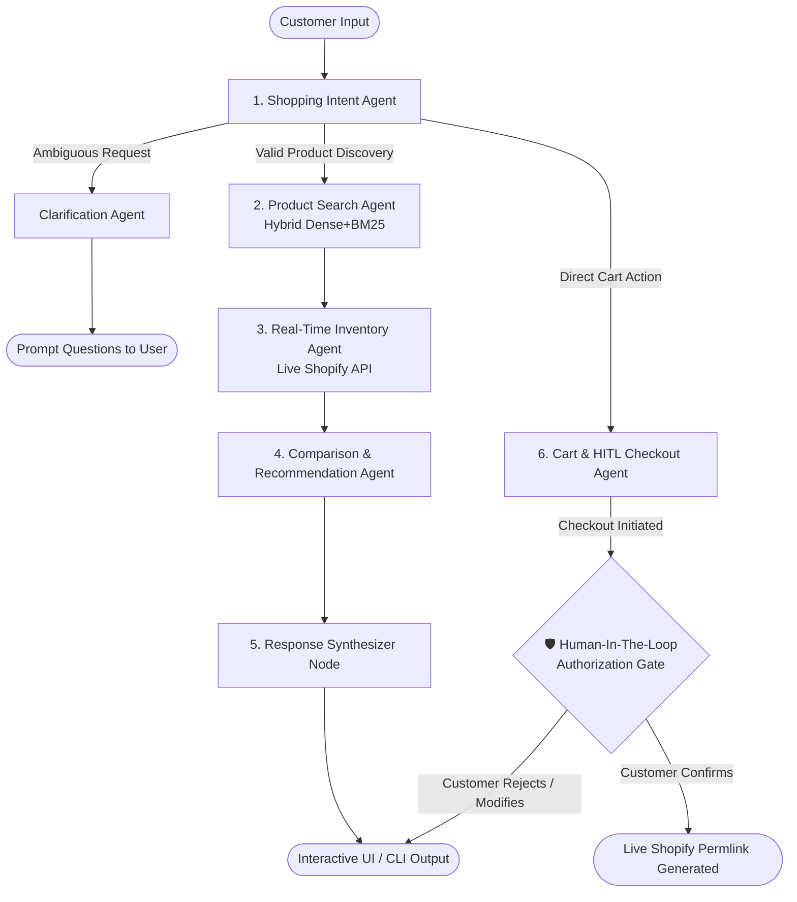

# E-Commerce Autonomous AI Shopping Agent 🛒🤖

> Production-ready Autonomous Shopping Agent built with **LangGraph**, **Hybrid Semantic Vector RAG**, **Real-Time Shopify API Inventory Verification**, and **Human-In-The-Loop (HITL) Guarded Checkout**.

---

## 🌟 Overview & Business Impact

Shopping across large e-commerce catalogues is overwhelming for customers due to spec complexity, varying prices, and fluctuating inventory. This solution delivers an **intelligent, autonomous multi-agent shopping assistant** that:
- Decodes natural-language intent (budget, specs, purpose, category, multilingual).
- Conducts **Hybrid RAG search** (Dense Semantic Vector Embeddings + BM25 sparse keyword matching + metadata filters).
- Generates side-by-side **multidimensional comparison matrices** (prices, discounts, benchmarks, pros/cons).
- Verifies **real-time Shopify inventory and variant levels** before recommending or adding items (zero hallucinated prices/stock).
- Manages an **autonomous shopping cart** with line-item totals, 18% GST, and dynamic shipping.
- Enforces strict **Human-In-The-Loop (HITL) approval** before generating checkout permalinks.

---

## 🏛️ Multi-Agent Architecture (LangGraph)



### Specialized Agents:
1. **Shopping Intent Agent (`app/agents/intent_agent.py`)**:
   - Parses budget constraints (e.g. `₹70,000`, `70k`, `under 70000`), currency, category, purpose (`programming`, `machine_learning`, `gaming`), and preferred hardware specs.
   - Triggers clarification questions if the request lacks essential context.
2. **Product Search Agent (`app/agents/search_agent.py`)**:
   - Executes dense semantic vector cosine similarity fused with Okapi BM25 keyword retrieval.
   - Enforces hard price bounds and spec bonuses.
3. **Product Comparison Agent (`app/agents/comparison_agent.py`)**:
   - Generates side-by-side matrices covering CPU, GPU, RAM, storage, display, ratings, warranty, performance score, and value-for-money score.
   - Synthesizes clear pros, cons, and an expert verdict.
4. **Personalized Recommendation Agent (`app/agents/recommendation_agent.py`)**:
   - Scores candidates based on customer purpose alignment (e.g. CUDA Tensor cores for ML, 16GB RAM for Docker/compilation).
   - Explains transparent rationale (*"Why this is recommended for you"*).
5. **Real-Time Inventory Agent (`app/agents/inventory_agent.py`)**:
   - Connects to Shopify API (or Storefront simulator) to inspect real-time variant quantities, identify out-of-stock SKUs, and refresh live prices.
6. **Autonomous Cart & HITL Checkout Agent (`app/agents/cart_agent.py`)**:
   - Handles item addition, quantity updates, subtotal, 18% GST, and shipping.
   - **Never charges payments or places orders autonomously**: Presents order breakdown and requires explicit customer authorization before generating checkout sessions.

---

## 🚀 Quick Start Guide

### 1. Installation & Environment
```bash
# Navigate to project
cd C:\Users\LENOVO\.gemini\antigravity\scratch\ecommerce-agent

# Activate virtual environment
.\.venv\Scripts\activate

# Install dependencies (already installed)
pip install -r requirements.txt
```

### 2. Launch Interactive Web Dashboard
```bash
python main.py
```
Open [http://localhost:8000](http://localhost:8000) in your browser.

### 3. Launch Interactive Terminal CLI
```bash
python main.py --cli
```

---

## 🧪 Automated Test Suite

Run the full pytest suite:
```bash
pytest tests -v
```

All 7 test suites cover:
- Intent extraction & clarification rules (`test_intent.py`)
- Hybrid search ranking & budget bounds (`test_search.py`)
- Markdown comparison matrix synthesis (`test_comparison.py`)
- Real-time Shopify inventory & out-of-stock detection (`test_inventory.py`)
- Cart calculation & Human-In-The-Loop approval gate (`test_cart_hitl.py`)
